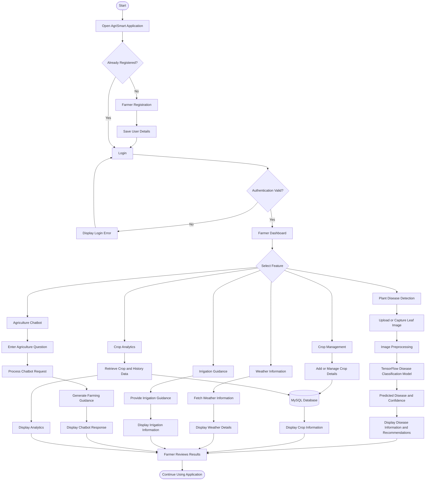
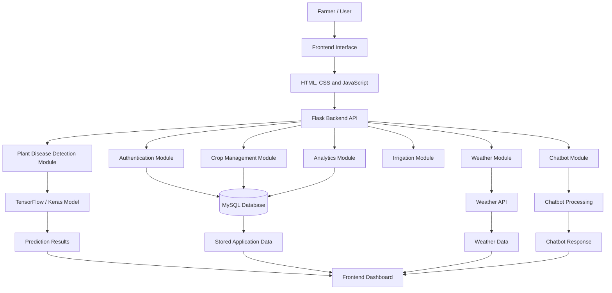
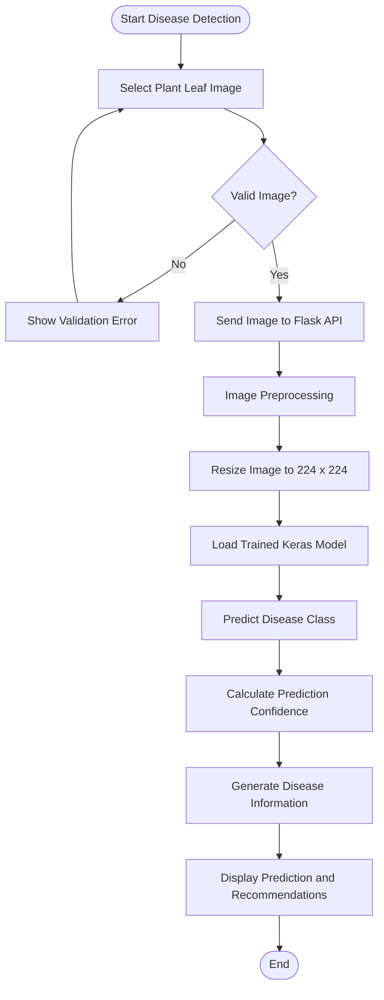

# 🌱 Smart Agriculture Assistant (AgriSmart)

An intelligent, multilingual agriculture support platform designed to help farmers monitor crops, identify plant diseases, access farming guidance, and make better agricultural decisions.

## 📌 About the Project

**Smart Agriculture Assistant (AgriSmart)** is a web-based application developed to support farmers through digital agricultural services. It provides plant disease detection using image classification, crop management, irrigation guidance, weather information, and an interactive chatbot.

The platform supports **English, Marathi, and Hindi**, making agricultural information more accessible to farmers.

## ✨ Key Features

- 🌿 **Plant Disease Detection:** Upload or capture a leaf image to identify potential plant diseases.
- 💬 **Agriculture Chatbot:** Get answers to agriculture-related questions and farming guidance.
- 🌾 **Crop Management:** Manage crop information and maintain crop history.
- 💧 **Irrigation Guidance:** Access irrigation-related recommendations.
- 🌦️ **Weather Information:** View weather information to support farming decisions.
- 📊 **Farmer Dashboard:** Access farming information and analytics.
- 🌐 **Multilingual Support:** English, Marathi, and Hindi.
- 📱 **Progressive Web App:** Accessible mobile and desktop experience.
- 🔐 **Authentication:** Secure user authentication and farmer-specific access.

## 🔄 System Flow Diagram

The following diagram illustrates how the AgriSmart application works, from farmer interaction to processing and displaying results.



## 🏗️ Application Architecture



## 🧠 Plant Disease Detection Workflow

AgriSmart includes a deep learning-based plant disease classification module.



**Model details:**
- Image input size: 224 × 224 pixels
- Supported classes: 38
- Model format: Keras (`.keras`)
- Framework: TensorFlow
- Dataset: PlantVillage-based dataset

*Predictions are intended for informational support and should be verified with an agricultural expert before treatment decisions.*

## 🛠️ Technology Stack

| Category | Technologies |
|---|---|
| Frontend | HTML, CSS, JavaScript |
| Backend | Python, Flask |
| Database | MySQL |
| Machine Learning | TensorFlow, Keras |
| Image Processing | Pillow |
| Authentication | JWT |
| Containerization | Docker, Docker Compose |
| Web Server | Gunicorn, Nginx |
| Application Type | Progressive Web App (PWA) |

## 🏗️ Project Structure

```text
Smart-Agriculture-Assistant/
│
├── backend/
│   ├── app.py
│   ├── routes/
│   ├── models/
│   │   ├── plant_disease_model.keras
│   │   └── class_labels.json
│   ├── uploads/
│   └── requirements.txt
│
├── css/
├── js/
├── images/
│
├── index.html
├── login.html
├── register.html
│
├── Dockerfile
├── docker-compose.yml
├── .dockerignore
├── requirements-prod.txt
└── README.md
```

*This is a simplified overview; your actual project may contain additional files and folders.*

## ⚙️ Installation and Setup

### 1. Clone the Repository

```bash
git clone https://github.com/imranmestri7-lgtm/Smart-Agriculture-Assistant.git
```

### 2. Navigate to the Project

```bash
cd Smart-Agriculture-Assistant
```

### 3. Create a Virtual Environment

```bash
cd backend
python3 -m venv venv
```

Activate it:

**macOS / Linux**
```bash
source venv/bin/activate
```

**Windows**
```bash
venv\Scripts\activate
```

### 4. Install Dependencies

```bash
pip install -r requirements.txt
```

### 5. Configure Environment Variables

Create and configure your backend `.env` file with your database credentials, JWT secret, and required API credentials.

Never upload real passwords, API keys, or secret environment files to GitHub.

### 6. Run the Backend

```bash
python3 app.py
```

Backend address:

```text
http://127.0.0.1:5000
```

The frontend should be served through a local web server with the appropriate backend API configuration.

## 🐳 Docker Deployment

AgriSmart is containerized using Docker.

**Docker Hub Image:**

`imranmestri07/agrismart:latest`

### Pull the Docker Image

```bash
docker pull imranmestri07/agrismart:latest
```

### Build the Docker Image

```bash
docker build -t agrismart:latest .
```

### Run the Container

```bash
docker run -d \
  --name agrismart \
  -p 5000:5000 \
  agrismart:latest
```

*Configure the required database and application environment variables before deployment. This standalone command does not automatically start MySQL or Nginx.*

### Verify the API

```bash
curl http://127.0.0.1:5000/api/test
```

Expected response:

```json
{
  "status": "success",
  "message": "API connection successful"
}
```

For a complete multi-service deployment, configure `docker-compose.yml` before starting the services.

## 🔒 Security

- Keep environment variables and credentials private.
- Use strong JWT secrets.
- Configure database access securely.
- Restrict CORS to trusted frontend origins in production.
- Avoid exposing database ports publicly.

## 🚀 Future Enhancements

- IoT-based soil moisture monitoring.
- Smart irrigation automation.
- Crop yield prediction.
- Advanced weather-based farming recommendations.
- Additional crop disease classes.
- Improved offline functionality.
- More regional language support.

## 🎯 Project Objective

The main objective of AgriSmart is to make agricultural information and digital farming assistance more accessible, helping farmers identify crop problems, manage farming activities, and make informed decisions.

## 👨‍💻 Developer

**Imran Mestri**

- GitHub: [imranmestri7-lgtm](https://github.com/imranmestri7-lgtm)
- Project Repository: [Smart Agriculture Assistant](https://github.com/imranmestri7-lgtm/Smart-Agriculture-Assistant)
- Docker Hub: [agrismart](https://hub.docker.com/r/imranmestri07/agrismart)

---

⭐ If you find this project useful, consider giving it a star on GitHub!

**Built with ❤️ for smarter agriculture.**